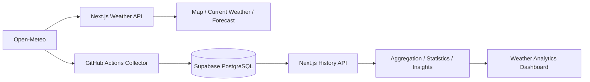

# BEYOND THE FORECAST

**Weather Analytics Platform สำหรับกรุงเทพมหานครและปริมณฑล**

🌐 **[เปิดใช้งานเว็บไซต์ → weather-analytics-platform.vercel.app](https://weather-analytics-platform.vercel.app/)**

เข้าใช้งานผ่านเบราว์เซอร์ได้ทันทีโดยไม่ต้องติดตั้ง เลือกพื้นที่บนแผนที่เพื่อดูสภาพอากาศ พยากรณ์ และ Dashboard ของพื้นที่นั้น

โครงงานที่ผสาน Software Development และ Data Analysis ตั้งแต่ดึงข้อมูลอากาศ จัดเก็บลงฐานข้อมูล ไปจนถึงวิเคราะห์และแสดงผลผ่านแผนที่ กราฟ และ Dashboard

ครอบคลุม **6 จังหวัด และ 79 เขต/อำเภอ** ได้แก่ กรุงเทพมหานคร นนทบุรี ปทุมธานี นครปฐม สมุทรสาคร และสมุทรปราการ รวมจุดอ้างอิงที่เก็บข้อมูล **85 พื้นที่**

## ฟีเจอร์

- Hero วิดีโอที่ขยายตามการเลื่อนหน้า พร้อมปุ่มเล่น/หยุดวิดีโอและรองรับ reduced motion
- แผนที่ขอบเขตจริงแบบลดรายละเอียด เลือกจังหวัดแล้วซูมใกล้เพื่อสำรวจเขต/อำเภอ พร้อมปรับกรอบจังหวัดให้ใช้พื้นที่มากขึ้น
- มุมมอง 2D / 2.5D พร้อมสีตามอุณหภูมิ ความชื้น หรือโอกาสฝน
- Current Weather และพยากรณ์ 3 วัน เปลี่ยนตามพื้นที่ที่เลือก
- Dashboard วิเคราะห์อุณหภูมิ/ความชื้น สลับช่วง 7/30 วัน พร้อมกราฟแบบโต้ตอบ
- สถิติค่าเฉลี่ย สูงสุด ต่ำสุด และ Insights จากข้อมูลชุดเดียวกับกราฟ
- เก็บข้อมูลเข้า Supabase ผ่าน GitHub Actions ทุกชั่วโมงที่นาที 17
- สถานะโหลด ข้อผิดพลาด และไม่มีข้อมูล โดยไม่ใช้ข้อมูลสมมติแทน

## วิธีสำรวจเว็บไซต์

1. เลื่อนหน้าจาก Hero เพื่อขยายวิดีโอ หรือกด **Scroll to explore** เพื่อไปยังแผนที่
2. เลือกจังหวัดบนแผนที่หรือจากรายการ ระบบจะซูมเข้าจังหวัด แล้วเลือกเขต/อำเภอที่ต้องการได้
3. สลับมุมมอง 2D / 2.5D หรือตัวแปรอากาศเพื่อดูสีของพื้นที่ กด **ภาพรวม** เพื่อกลับไปทั้ง 6 จังหวัด
4. กด **ดูข้อมูลพื้นที่นี้ ↓** เพื่อดู Current Weather พยากรณ์ และ Dashboard ของพื้นที่ที่เลือก
5. ใน Dashboard สลับอุณหภูมิ/ความชื้นและช่วง 7/30 วัน ชี้หรือแตะกราฟเพื่อดูรายละเอียด หรือเปิดตารางรายวันเพื่อตรวจจำนวนชั่วโมงที่เก็บได้

### เมื่อวิดีโอไม่เล่นหรือเปิดโหมดลดการเคลื่อนไหว

- หากเบราว์เซอร์พักหรือบล็อก autoplay ให้กด **เล่นวิดีโอ** มุมขวาบนของ Hero สามารถกดหยุดได้เช่นกัน
- เมื่อเปิด reduced motion วิดีโอจะไม่เล่นอัตโนมัติ แต่กดเล่นเองได้ การขยายตามการเลื่อนยังทำงาน โดยตัดความหน่วงจาก spring และการเลื่อนข้อความออกด้านข้าง
- Hero มีขนาดสำรองด้วย `vh` สำหรับเบราว์เซอร์ที่ไม่รองรับ `svh` และคำนวณขนาดโดยไม่ใช้การคูณความยาวใน CSS
- หากเพิ่งอัปเดตเว็บ ให้รอ Deploy สำเร็จแล้วรีเฟรช หากยังแสดงเวอร์ชันเก่า บน Windows ใช้ **Ctrl + F5**

## การทำงานของระบบ



เว็บอ่านข้อมูลปัจจุบันและพยากรณ์จาก Open-Meteo ส่วนกราฟย้อนหลังอ่านข้อมูลที่ระบบเก็บเองใน Supabase ตัวเก็บข้อมูลทำงานแยกจากเว็บไซต์ จึงไม่ต้องเปิดเครื่องหรือเว็บไว้เมื่อกำหนด GitHub Actions และ Secrets เรียบร้อยแล้ว

## Tech stack

| ส่วน | เทคโนโลยี |
| --- | --- |
| Frontend / Backend API | Next.js 16, React 19, TypeScript |
| Styling / Animation | Tailwind CSS 4, Framer Motion |
| Map / Charts | d3-geo, Visx |
| Cloud database | Supabase PostgreSQL พร้อม Row Level Security |
| Collection | Node.js 24, GitHub Actions |
| Local database ทางเลือก | SQLite ผ่าน `node:sqlite` |

## เริ่มรันบนเครื่อง

ต้องมี **Node.js 24**, npm และ Git

```bash
git clone https://github.com/kungnawanghin/weather-analytics-platform.git
cd weather-analytics-platform
npm ci
```

สร้าง `.env.local` ที่โฟลเดอร์หลัก ระดับเดียวกับ `package.json`:

```dotenv
SUPABASE_URL=https://YOUR_PROJECT_REF.supabase.co
SUPABASE_SECRET_KEY=YOUR_SERVER_SECRET_KEY
```

ใช้ Secret key ที่ขึ้นต้นด้วย `sb_secret_` เฉพาะฝั่งเซิร์ฟเวอร์ ห้ามเติม `NEXT_PUBLIC_` ห้าม commit ไฟล์นี้หรือส่งคีย์ผ่านแชต ไฟล์ `.env.local` ถูกละเว้นโดย Git อยู่แล้ว

สำหรับฐานข้อมูลใหม่ ให้รัน [schema](database/supabase-schema.sql) ใน Supabase SQL Editor **ครั้งเดียว** แล้วเพิ่มรายชื่อพื้นที่:

```bash
node scripts/seed-supabase.cjs
npm run dev
```

ถ้าใช้ฐานข้อมูลเดิมที่เตรียมไว้แล้ว ไม่ต้องสร้างตารางใหม่ เปิดเว็บที่ [localhost:3000](http://localhost:3000) หรือพอร์ตที่ Terminal แจ้ง หากยังไม่ได้ตั้งค่า Supabase ส่วนข้อมูลย้อนหลังจะแสดงข้อผิดพลาด ส่วนข้อมูลสดยังใช้ API แยกกัน

## เก็บและดูข้อมูล

```bash
# ทดลองเก็บข้อมูล 3 พื้นที่
node scripts/collect-supabase.cjs --limit 3

# เก็บครบ 85 พื้นที่
node scripts/collect-supabase.cjs --all

# ดูข้อมูลล่าสุดในฐานข้อมูลออนไลน์
node scripts/view-supabase.cjs
```

ตาราง `areas` เก็บพื้นที่และพิกัด ส่วน `weather_records` เก็บค่าอากาศพร้อมเวลา ข้อมูลซ้ำจะถูกข้ามด้วยคีย์ `(area_id, source, model, valid_at)` โดยไม่เขียนทับเวลาเก็บเดิม

สำหรับการเก็บอัตโนมัติ ให้ตั้ง Repository Actions Secrets ชื่อ `SUPABASE_URL` และ `SUPABASE_SECRET_KEY` แล้วใช้ workflow [Collect weather hourly](.github/workflows/collect-weather.yml) บน default branch กดรันเองได้จากแท็บ [Actions](https://github.com/kungnawanghin/weather-analytics-platform/actions) งานบน GitHub ไม่จำเป็นต้องติดตั้ง dependency ของเว็บหรือเปิด Next.js server

ตารางเวลาของ GitHub อาจล่าช้าหรือข้ามรอบ และ repo สาธารณะที่ไม่มีความเคลื่อนไหว 60 วันอาจถูกปิด scheduled workflow ไม่ใช่บริการรับประกันการเก็บตรงเวลาทุกชั่วโมง

## อ่านผลวิเคราะห์อย่างไร

- ใช้เวลาไทยในการแบ่งวัน ช่วง 30 วันสิ้นสุดวันนี้ และ 7 วันคือ 7 วันท้ายของชุดเดียวกัน
- เลือกค่าล่าสุดหนึ่งรายการต่อชั่วโมง แล้วหาค่าเฉลี่ยจากชั่วโมงที่เก็บได้ในแต่ละวัน
- วันซึ่งยังเก็บไม่ครบ 24 ชั่วโมงระบุจำนวนชั่วโมงใน Tooltip และตาราง จึงอาจไม่ใช่ค่าเฉลี่ยเต็มวัน
- วันที่ไม่มีข้อมูลเป็นช่องว่าง ไม่เติมศูนย์หรือยืมข้อมูลจากวันอื่น เส้นกราฟต้องมีอย่างน้อย 2 วัน
- ค่าเฉลี่ยช่วงที่เลือกให้น้ำหนักแต่ละวันที่มีข้อมูลเท่ากัน ค่าสูงสุด/ต่ำสุดเป็นค่าของค่าเฉลี่ยรายวัน
- Insight เปรียบเทียบ 3 วันแรก/ท้ายต้องมีข้อมูลครบ 24 ชั่วโมงในแต่ละวันที่ใช้ มิฉะนั้นแจ้งข้อมูลไม่เพียงพอ
- ข้อมูลเป็นค่าจากแบบจำลอง ณ จุดอ้างอิง ไม่ใช่ค่าจากสถานีหรือค่าเฉลี่ยทั้งจังหวัด/เขต
- ความสูงในแผนที่ 2.5D เป็นเอฟเฟกต์ ไม่ใช่ระดับความสูงภูมิประเทศหรือระดับเตือนภัย

Dashboard ปัจจุบันใช้ข้อมูลที่เก็บใน Supabase ไม่ได้ใช้ ERA5 เป็นแหล่งข้อมูลย้อนหลัง และไม่ได้ย้ายข้อมูล SQLite เดิมขึ้นออนไลน์โดยอัตโนมัติ

## โครงสร้างสำคัญ

```text
app/                    หน้าเว็บและ API routes
components/ui/          Hero และกราฟแบบโต้ตอบ
components/weather/     แผนที่ การ์ด Dashboard และ Insights
lib/                    Registry พื้นที่ การเรียกข้อมูล และการวิเคราะห์
public/maps/            ขอบเขตแผนที่และเครดิตแหล่งข้อมูล
database/               Schema ของ PostgreSQL และ SQLite
scripts/                Seed, collector และชุดทดสอบ
.github/workflows/      งานเก็บข้อมูลอัตโนมัติ
docs/                   คู่มือระบบและ Deploy
```

## ตรวจสอบและ Build

```bash
node scripts/test-supabase.cjs
node scripts/test-collected-history.cjs
node scripts/test-weather-api.cjs
node scripts/test-hero.cjs
npm run lint
npm run build
```

ชุดทดสอบข้างต้นไม่เขียนข้อมูลลง Supabase จริง ส่วนคำสั่ง `collect-supabase.cjs` เป็นการดึงและบันทึกข้อมูลจริง หลัง build สามารถรัน production บนเครื่องด้วย `npm start`

`test-hero.cjs` ตรวจเฟรมเริ่ม กลาง และสุดท้ายของการขยายในโหมดปกติและ reduced motion รวมถึงระยะเลื่อน ขนาด และการมีปุ่มเล่นวิดีโอ เป็นการตรวจการเรนเดอร์แบบแยกส่วน ไม่ได้ยืนยันการเล่นไฟล์วิดีโอหรือหน้าตาบนทุกอุปกรณ์ จึงควรลองเลื่อนและเล่น/หยุดบนเบราว์เซอร์จริงด้วย

## เอกสารและการ Deploy

- [Weather API และหลักการวิเคราะห์](docs/weather-api.md)
- [ตั้งค่า Supabase และตัวเก็บข้อมูล](docs/supabase-collection.md)
- [Deploy บน Vercel และรายการตรวจหลัง Deploy](docs/deployment.md)

เว็บไซต์ Deploy บน Vercel แล้วที่ [weather-analytics-platform.vercel.app](https://weather-analytics-platform.vercel.app/) ส่วนการเก็บข้อมูลอัตโนมัติทำงานแยกผ่าน GitHub Actions และ Supabase

หากนำโปรเจกต์ไป Deploy เอง ต้องตั้งตัวแปรฝั่งเซิร์ฟเวอร์ใน Vercel แยกจาก GitHub Secrets ตามคู่มือด้านบน

## แหล่งข้อมูลและเครดิต

- สภาพอากาศ: [Open-Meteo](https://open-meteo.com/), [CC BY 4.0](https://creativecommons.org/licenses/by/4.0/)
- ขอบเขตแผนที่: geoBoundaries / OpenStreetMap และ RTSD / OCHA ดูปีข้อมูลและข้อกำหนดใน [เครดิตแผนที่](public/maps/README.md)
- จุดอ้างอิงลาดพร้าว: [GeoNames](https://www.geonames.org/6845305/lat-phrao.html)

ใช้เพื่อการศึกษาและ Portfolio ไม่ใช่ระบบประกาศเตือนภัยอย่างเป็นทางการ
